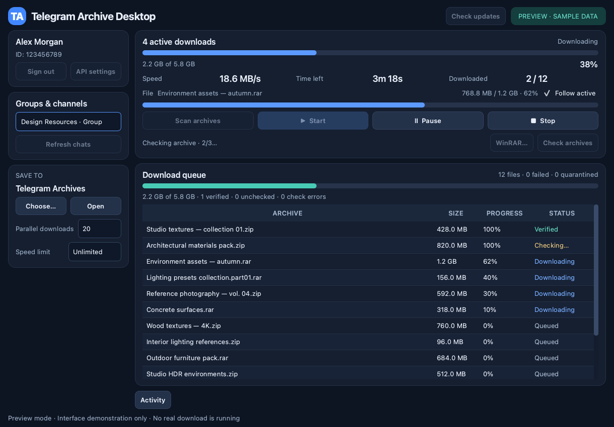

# Telegram Archive Desktop

A standalone Windows application for downloading ZIP and RAR attachments from Telegram groups and channels that your account can access. Built with Python, PySide6 and Telethon. **No 3ds Max or other host application is required.**

## Start here

1. Extract the entire project into a writable folder, for example `C:\TelegramDownloader`. Do not run directly inside a ZIP or place it in `Program Files`.
2. Double-click **`Start.bat`**. This is the only launch file you need. It finds a suitable Python 3.14 or downloads an official private runtime automatically, then installs the dependencies and opens the app. No manual Python installation or administrator rights are needed.
3. Open **API settings**, enter your API ID and API Hash, then click **Save**. Get them from [Telegram API development tools](https://my.telegram.org/apps).
4. In Telegram on your phone, open **Settings → Devices → Link Desktop Device** and scan the displayed QR code. If requested, enter your two-step verification password in the application.
5. Choose a group or channel, choose a download folder, click **Scan archives**, then **Start**. Up to **20 archives download simultaneously** by default. Use **Parallel downloads** in the sidebar to choose 1–20; the setting is remembered. Stop the queue before changing it.

The selected chat is remembered for each account and restored next time. The chat selector stays available during scanning, downloading, and pauses. Switching chats safely stops the current operation, retains its partial files, and opens the other chat's saved queue. **Downloads never start automatically on launch or chat selection.**

For a desktop shortcut, right-click `Start.bat` → **Show more options → Send to → Desktop (create shortcut)**. Keep the project folder in place. The shortcut still points to the same single launcher.

## Download performance

The launcher installs **cryptg 0.6.0** automatically on Python 3.11–3.14 and checks that Telethon uses it. This accelerates encryption/decryption; actual download speed still depends on Telegram, the connection, and disk activity. The Activity log reports the active encryption backend.

The normal Windows launcher automatically uses Python 3.14 with cryptg in `.venv-py314`, including when upgrading from a Python 3.15 environment. The old `.venv` is retained. If Python 3.14 is missing, the official full runtime is downloaded to `%LOCALAPPDATA%\TelegramZipDesktop\runtime` and checked against a pinned SHA-256 before use. System Python, PATH, file associations, credentials, and downloads are unchanged. Source development on Python 3.11–3.15 remains supported.

Intermediate download progress is batched into one database transaction about once per second for all transfers. Combined statistics refresh about four times per second, instead of rescanning the queue for every file callback. Completion and stop/error state changes commit the latest progress immediately; pause and orderly shutdown also flush pending checkpoints. Resume still uses the actual `.part` file length, so a stale display checkpoint cannot cause the whole file to restart.

## What is included

- Compact dark interface with a larger queue, current-file and overall progress, speed, time remaining, and a collapsible Activity log.
- A separate **File** progress bar shows one archive's name, downloaded bytes, and percentage. Select a queue row to inspect it, or keep **Follow active** enabled to follow downloads automatically.
- **Speed limit** dropdown: Unlimited by default, or 10 / 5 / 2 / 1 / 0.5 / 0.25 MB/s shared across all downloads. Change it live; the choice is remembered.
- **Check updates** downloads the latest public GitHub main version and restarts through the dependency launcher. Settings, sessions, downloads, and the queue are preserved.
- Groups and channels, including archived dialogs; searchable chat selector and automatic restoration of the last selection.
- ZIP and RAR selection: `.zip` / `.rar` filenames, case-insensitive; nameless documents require a matching MIME type.
- Original filenames are preserved, including extension case and long names. Only collisions add a removable prefix such as `__dup_2__`; Windows-invalid characters still need replacement.
- Completed archives saved with old numbered names are restored automatically for the selected chat, including files in `wrong_archives`, using verified Telegram metadata and a recoverable rename journal.
- Automatic background checks with installed WinRAR after each download, while other files download, plus **Check archives** for previously downloaded files. Three confirmed password/archive failures move the file to `wrong_archives` without overwriting existing files.
- Pause, resume, stop, network retries, rate-limit waits, and resumable `.part` files.
- Durable SQLite queue and incremental history-scan checkpoints, isolated by Telegram account and chat.
- QR sign-in with automatic code refresh and optional two-step verification password.
- API credentials **and the Telegram authorization session** encrypted with Windows DPAPI. No plaintext session file is written by the application.
- Optional import of the old `telegram_config.json` and `telegram_zip_session.session`.
- One running instance per Windows user; orderly worker shutdown when the window closes.
- Automated tests and a manually started Windows GitHub Actions workflow for Python 3.11–3.15. Pushes do not launch it or generate failure-notification emails from this workflow.

## Archive checks and upgrading

Install [WinRAR for Windows](https://www.win-rar.com/download.html) to enable archive checks. The app detects standard installations; otherwise use **WinRAR…** to select `WinRAR.exe`. The selected path is remembered. WinRAR is a separate licensed application and is not bundled or installed by the Python setup. Downloads work without it and remain **Unchecked**.

Checks follow the supplied `check_archives.bat` policy: test without a password, retry up to three times, and move only when all three results are codes 2, 3, or 11. Operational errors leave files in place. Files move to `wrong_archives` inside their existing chat download folder and are not downloaded again. Up to 20 downloads and one archive check can run at the same time. Each free download slot immediately picks up the next archive; it does not wait for a batch to finish. The main card shows active downloads, overall progress, combined speed, and estimated time for the queue. Each row shows that archive’s progress. Telegram and your connection determine actual throughput; 20 transfers do not guarantee a 20-fold speed increase. Reduce Parallel downloads if you encounter frequent rate limits. If checking takes longer, completed files wait in a saved check queue. **Start** also resumes pending checks after a stop or restart. Pause, Stop, chat switching, and closing the window apply to all downloads and the archive checker. The app finishes the remaining check queue after the last download. Use **Check archives** to recheck the current chat's previously downloaded files; hover over any status for details. This does not guess passwords or accept archive passwords.

After updating, click **Scan archives** once in each saved chat to discover historical RAR attachments. Existing downloaded ZIPs, partial files, credentials, and selected chats are retained. The application data folder remains `%LOCALAPPDATA%\TelegramZipDesktop` for compatibility. Launching still uses only **Start.bat**.

## Update the application

Click **Check updates** in the header while no operation is running. The app checks the latest commit on this repository's `main`, downloads it in the background, saves its state, installs the update after closing, and restarts automatically. It uses the public GitHub API without a token. **Stop** cancels preparation before installation.

ZIP installations receive a commit-pinned source archive; the app checks the package, backs up managed files, and restores them if replacement fails. Git installations require Git on PATH, a clean `main`, and fast-forward history; local source changes are never discarded. The restarted launcher installs changed Python dependencies if needed. See the user guide for recovery and limits.

Versions released before this button was added need one manual update: download the latest repository ZIP (or pull `main`) and replace the application sources. Keep your `.venv`, application data, and downloads. Future versions can use the button.

## Documentation

- [Detailed user guide](docs/USER_GUIDE.md)
- [Architecture and development](docs/DEVELOPMENT.md)
- [Validation results and limitations](docs/VALIDATION.md)
- [Third-party dependencies](THIRD_PARTY_NOTICES.md)

## Important boundaries

The app uses the permissions of your own Telegram account. It does not join groups, bypass permissions or content restrictions, scrape invite links, or download inaccessible material. Telegram must be reachable from your computer. A custom proxy UI is not included.

Archives are not extracted or executed. A completed download is **Unchecked** until WinRAR successfully tests it. **Verified** means the archive passed a password-free WinRAR test; it is not an antivirus or authenticity check. Known multipart `.partNN.rar` sets require manual validation with all volumes present.

This is a source distribution with a launcher, **not a signed Windows EXE installer**. The launcher downloads an official private Python runtime when required and application libraries from PyPI. First-time setup requires internet access and Windows PowerShell; subsequent healthy launches reuse the prepared environment. Actual Telegram login and downloading require your account and have not been exercised against a real account in the development environment. See the validation document for precise test coverage.
