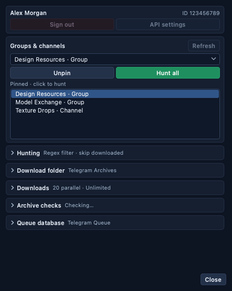

# User guide

## 1. System requirements

- Windows 10 or 11, x64, with Windows PowerShell available. Python is prepared automatically; you do not need to install it manually.
- An internet connection, access to Telegram, and enough space for the dependencies and downloaded archives. Allow roughly 1 GB for setup, in addition to your downloads.
- A Telegram account already authorized in the official mobile app and already able to open the required group or channel.
- Your own API ID and API Hash from `https://my.telegram.org/apps`.

The application is independent of 3ds Max. It runs as a normal desktop program.

The application version appears beside **Telegram Archive Desktop** in the top header and in the window title.

## 2. Install and launch

Extract **all files** into a writable directory, such as `C:\TelegramDownloader`. Avoid very long paths. Double-click **Start.bat** every time you want to open the app.

The launcher looks for standard 64-bit Python 3.14 with Tcl/Tk, venv, and ensurepip. It checks the existing application environment, private runtime, Windows Python launcher, and PATH. If none is suitable, it downloads the official full Python 3.14.8 x64 ZIP from python.org, verifies its pinned SHA-256, and prepares it under `%LOCALAPPDATA%\TelegramZipDesktop\runtime`. No administrator access, system Python replacement, or PATH change is needed. The first download shows progress in the launch window.

The application dependencies, including cryptg, are installed into `.venv-py314` inside the project. On an update from an older environment, this happens automatically. The old `.venv` is kept. Account credentials, selected chat, queue, downloads, and partial files stay where they are. The same runtime preparation runs after **Check updates**, even if the old app used Python 3.15.

Once prepared, the runtime and environment are reused. Launching again does not download Python each time. If Python download verification or dependency installation fails, setup reports the error; check the connection and run Start.bat again. A broken managed environment is renamed to `.venv-py314.previous-…` before rebuilding, so its contents are retained. An incomplete runtime download is never used.

Keep the project in a writable folder and do not move it while it is running. If you move it later and setup cannot repair the environment automatically, close the app, rename `.venv-py314` to `.venv-py314.previous-manual`, and run Start.bat. Leave `%LOCALAPPDATA%\TelegramZipDesktop` and your downloads intact.

You may create one Windows desktop shortcut to Start.bat using the **Send to → Desktop (create shortcut)** menu. You do not need separate download and QR-login launchers.

## 3. Enter API credentials

Open **API settings**. Enter your API ID (a positive number) and API Hash (32 hexadecimal characters). The hash input is masked. The **Open Telegram API settings** button opens Telegram's official API page.

After Save, the credentials are protected using the current Windows user's DPAPI. They are not stored in a plaintext JSON configuration. The settings dialog deliberately does not display a previously saved hash. To change credentials, enter both fields again or import the old configuration.

## 4. Sign in with the QR code

The QR window appears when the saved session is missing or no longer authorized. On your phone:

1. Open Telegram.
2. Open **Settings → Devices → Link Desktop Device**. Wording can differ slightly between Telegram versions.
3. Scan the code shown on your computer and confirm the device.

The code refreshes automatically if it expires. Keep it private. The application renders it in memory and does not save a QR image to disk.

If two-step verification is enabled, enter your Telegram password in the password dialog. Incorrect passwords can be retried. The password is never added to the saved credentials. Canceling either sign-in dialog stops authorization.

Once connected, the account name and numeric account ID appear on the left. Normally later launches reuse the encrypted session and reconnect without another QR scan. **Sign out** revokes this app's Telegram session and removes its saved authorization. It keeps the API credentials, queue, selected-chat preferences, and downloaded files.

## 5. Pick a group or channel once

Use **Groups & channels**. You can type part of a name to search, or use the drop-down list. Hover over a list entry to see its numeric chat ID when names are identical.

The list includes groups, broadcast channels, private chats of those types, and archived dialogs visible to the signed-in account. Ordinary one-to-one conversations are not included.

The last selected chat is saved per Telegram account. On the next launch, it is automatically selected after the account reconnects and the chat list loads. If that chat has become inaccessible, the app explains this and leaves the selection empty; it never silently starts using a different chat.

The selector stays available while downloads are running or paused. Selecting another chat cancels the current operation cleanly, keeps its `.part` file and queue, and displays the chosen chat. Return to the original chat and press Start to resume its work. **Refresh chats** is available when no operation is active; stop the current operation first if you need to refresh the list.

If a private group is missing, check that it opens in Telegram under the same account ID shown in this app. Then click Refresh chats. The app does not accept invite links or join groups automatically.

### Pinned chats and hunting

Pin the groups you check often: select a chat and click **Pin** (the button changes to **Unpin** for a pinned chat). Pinned chats appear in a scrollable list under the selector, saved per Telegram account. **Clicking a pinned chat starts hunting it**: the app selects the chat, scans only messages newer than its saved checkpoint, and immediately downloads the archives allowed by the **Hunting** rules below. Clicking another pinned chat stops the current operation as a normal chat switch does; clicking the chat that is already running does nothing. Ordinary chat selection and app launch still never start downloads.

The **Hunting** card holds global rules for all chats:

- **Name filter** (on by default): download only archives whose filename matches. **Regex** uses a Python regular expression and is case sensitive; **Text** matches any part of the filename and ignores case. The default regex `^[0-9a-z]+\.[0-9a-z]+\.(zip|rar)$` matches names generated by a PHP uploader, such as `7407604.67a7dac35b142.rar`: lowercase letters or digits, one dot in the middle, and a lowercase `.zip` or `.rar` extension. **Default** restores this pattern. An invalid regex is outlined in red and is not saved.
- **Skip already downloaded** (on by default): skip an archive when a file with the same name (ignoring case) or the same Telegram document was already downloaded in **any** chat. Files marked as already downloaded in the queue count too. Archives moved to `wrong_archives` do not, so another copy can still be downloaded. Two matching files found in one pass download only once.

Scanning always records every ZIP and RAR archive; the rules decide what downloads. Skipped archives stay in the queue with the **Skipped** status and their reason in the tooltip. Changing a rule takes effect immediately for the selected chat: newly excluded files become Skipped, and files the new rules allow return to the queue. During a running download, files allowed again before the current position wait for the next Start.

## 6. Choose where archives are saved

Click **Choose…** in the **Settings** block and select a local folder with enough free space. The location is remembered. By default **all chats save into this one folder**. Enable **Folder per chat** to give each chat its own subfolder (`account_<ID>\chat_<ID>`). **Open** opens the folder where the selected chat's files are saved: the chosen folder, or the chat's subfolder when Folder per chat is on. If that folder has not been created yet, the app shows its path and asks you to start a download.

Files are organized as:

```text
<chosen folder>\                                   (default: one folder)
<chosen folder>\account_<account ID>\chat_<chat ID>\   (Folder per chat)
    Chair Model.ZIP
    Living Room.rar
    __dup_2__Chair Model.ZIP    (only if that name is already taken)
    wrong_archives\    (files that failed three archive checks)
```

Original filenames are preserved, including spaces, Unicode, and `.ZIP` / `.RAR` capitalization. No message/document numbers are added and long names are not silently shortened. Windows-invalid characters are replaced and reserved device names receive an underscore. A nameless attachment uses `archive_<message ID>.zip` or `.rar`. Names that exceed the filesystem's limits are reported as errors. Keep the chosen folder path short enough for Windows path limits; `C:\TelegramFiles` is a good example.

If a name is already used by another queue entry, a local file, a folder, or a partial download, the next available prefix is added: `__dup_2__`, `__dup_3__`, and so on. Comparisons ignore case, as on Windows. The same prefix convention applies to collisions inside `wrong_archives`. Existing files are never deliberately overwritten.

To remove an added prefix later, select the relevant files in Total Commander's **Multi-Rename Tool**, enable **RegEx**, search for `^__dup_[0-9]+__`, and leave **Replace with** empty. Keep the filename/extension masks unchanged and review the preview before applying. Separate duplicates into different folders first if removing prefixes would recreate identical names. Only select files to which the app added a prefix. See [Total Commander's rename tool](https://www.ghisler.com/screenshots/en/06.html). Finish downloads and archive checks before renaming: saved queue paths do not track external renames.

After updating, unfinished entries from the old numbered-name queue adopt the original Telegram filename when downloaded. Existing partial data stays at its saved temporary path and is finalized under the new name after completion, including across restarts.

**Already downloaded files are repaired automatically.** After signing in, the app restores old numbered names in the remembered chat. Selecting another chat restores that chat's files; Scan, Start, and Check archives also retry outstanding work. No extra launcher or manual filename mask is needed. The main card shows **Restoring filenames…** with progress; Pause, Stop, chat switching, and closing the app remain available.

The app uses its saved queue to locate each file, then fetches original names from Telegram in batches. It checks the message's document ID and size, restoring the full name even if the previous version shortened it. Files in `wrong_archives` stay in that folder with their verification status preserved. Duplicate names receive the same `__dup_2__` convention. Queue paths are updated together with a durable rename record, so interrupted renames can be recovered without downloading the archive again.

Only tracked completed files matching the old naming scheme are eligible. Missing files, changed sizes, symbolic links, unavailable/edited Telegram attachments, and files locked by other programs are left alone. Files outside the saved queue are not guessed from their names. View **Activity** for restored/skipped counts; unlock files and refresh the chat list or press Start to retry. If recovery detects conflicting files at the saved source and destination, it preserves both and stops that operation for inspection. Keep `queue.sqlite3` when updating; without the queue and access to the original Telegram messages, full names cannot be recovered reliably.

**Open** opens the currently selected base folder in Explorer. Hover over a queue row to see that file's full path, or its error if it has failed.

Changing the folder or **Folder per chat** applies to every archive **without downloaded data** when its download starts, including queue entries found earlier. Archives with a `.part` file or downloaded bytes, and completed archives, stay where their data is, so incomplete downloads still resume safely. Do not move `.part` files while downloading.

## 7. Scan and download

**Scan archives** reads message history from oldest to newest and saves matching ZIP and RAR documents to the queue. The first scan can take time in a large group. The footer shows the number of messages checked; the queue fills as files are found.

Only filenames ending in `.zip` or `.rar` are selected, case-insensitively. If a document has no filename, its MIME type must indicate ZIP or RAR. An explicit filename takes precedence over MIME metadata: `.zip.exe`, `.rar.exe`, `.7z`, `.z01`, and legacy `.r00` files are excluded. Modern `.part01.rar` volumes are downloaded individually, but are not assembled or automatically verified. Collect all parts with matching original volume names before checking such a set manually in WinRAR.

On the first launch after upgrading from the ZIP-only release, scan checkpoints reset once so the next **Scan archives** can discover older RAR files. Existing queue rows, partial files, and completed ZIPs stay intact. Subsequent scans resume incrementally as before.

The scan checkpoint is saved after each processed message. Stop, close, or restart the app, then click Scan archives to continue. Later scans look for newer messages, so they do not need to re-read the full history. They do **not** revisit older edited messages. A file whose document ID or size changed after discovery is reported as failed instead of appending different content to an existing partial file.

Click **Start** after scanning to process the saved queue with up to **20 simultaneous downloads** by default. Use **Parallel downloads** under the destination folder to choose a limit from 1 to 20. Change the limit while downloading or paused; your selection is saved between launches. Raising the limit starts extra files immediately unless paused or Finish current is active. Lowering it never interrupts a file: current downloads finish, and new ones start only when the active count falls below the new limit. For example, changing 10 to 3 keeps all ten current downloads, then settles at three. The header shows the actual count and target, such as **8 active · Limit 3**. Changes while paused take effect on Resume; changes during Finish current are saved for the next Start and do not restart the queue. Each available slot starts the next archive without waiting for the other downloads to finish. Start also retries failed items once per queue pass. Completed downloads are skipped. Any pending archive checks are resumed alongside new downloads.

Use **Speed limit** in the same sidebar to select **Unlimited** (default), **10 MB/s**, **5 MB/s**, **2 MB/s**, **1 MB/s**, **0.5 MB/s**, or **0.25 MB/s**. This is the combined archive-download limit across all active files, not a separate allowance for each file. It is saved between launches and can be changed while downloading or paused. Selecting Unlimited wakes transfers waiting for bandwidth; changing this setting does not resume a paused queue.

The limit uses the same binary units as the progress display: 1 MB/s means 1,048,576 archive bytes per second. Requests are paced in chunks of up to 512 KiB, so short bursts and fluctuating displayed speeds are normal. Requests already in flight when you lower the limit may finish; the new budget applies to subsequent requests. Network/protocol overhead, Telegram metadata, and application-update downloads are outside this limit. Pause, Stop, and closing the window interrupt bandwidth waits and preserve partial files.

The window opens at **1150×640** and can shrink to **500×340**. The sidebar scrolls when its cards do not fit; the pinned chat list stays near the top. At 900 pixels wide or less, or below 540 pixels high, the sidebar moves into the **Settings** window; it contains the same account, chat, pinned-chat, Hunting, folder, download-limit, and archive-check controls. Widening the main window restores the sidebar after Settings closes. The active-file strip scrolls horizontally when the tiles need more space; in narrow windows the queue also scrolls horizontally. Very short windows hide secondary metrics and tile filenames, retaining progress percentages and tooltips. **Activity** opens a separate log window so it does not squeeze the queue. Closing the main window closes these auxiliary windows and performs the normal safe shutdown.

The **Settings** window opens at **480×600** and can shrink to **320×340**. Cards fill the available width and switch to two columns when the content area reaches 640 pixels. At smaller heights, scroll the settings while the **Close** button stays visible. Download limit fields align in a form and wrap below their labels when needed. Resizing or closing Settings preserves the current chat and values.



The compact interface gives most of the window to the queue. Shorter controls and dense rows keep more archives visible without reducing the main text size. **Activity** in the queue header opens or closes the session log window; it is closed by default. **WinRAR…** and **Check archives** are grouped under **Archive checks** in the left sidebar, with a separate background-check status. Extra explanations and full truncated names are available in tooltips.

Below the overall metrics, a single horizontal row shows **one progress bar for each active download**. Two simultaneous downloads show two bars; ten show ten, up to the 20-download limit. Percentages stay visible; long names are shortened to fit. Hover over a tile for its full filename, byte counts, status, and saved path. The row updates independently of the queue page and filter. Pause retains its progress; completed/stopped transfers leave the row as their slots close.

The active bars have wider gaps to keep files visually separate. There is one overall bar and one bar per active file; the controls sit directly below them. Individual progress and byte counts for queued or completed files remain in the table. Selecting a row does not change the upper bars.

The interface shows:

| Display | Meaning |
| --- | --- |
| Main download bar | Received bytes across the full queue; the title shows the number of active downloads |
| Active download row | Independent progress and percentage for every currently active transfer |
| Transferred | Downloaded bytes / full size for each archive, updated during transfer |
| Row progress | A small progress bar and percentage for each individual archive |
| Transfer speed | Combined recent speed of active downloads; resets when paused or stalled |
| Time left | Estimated remaining queue download time, based on combined speed; archive check time is not included |
| Files downloaded | Full byte count received divided by all discovered files; includes quarantined files |
| Green queue bar | Received bytes across the queue; a failed partial file can still contribute bytes |
| Unchecked | Download complete; no successful WinRAR test yet |
| Checking… | WinRAR is testing the archive without a password |
| Verified | WinRAR returned success |
| Quarantined | Three confirmed failures; file moved to `wrong_archives` |
| Check failed | Could not reliably test or move the file; hover for details |
| Failed | Hover over the row and check Activity for the reason |
| Skipped | Excluded by a Hunting rule; hover for the reason. Not downloaded unless the rules change |

The queue processes every saved entry that the Hunting rules allow. The filter next to **Download queue** has four modes:

- **Unfinished** (the default each launch): queued, downloading/paused, and failed downloads.
- **Downloaded**: completed downloads, including archives awaiting checks, being checked, failing checks, or moved to `wrong_archives`.
- **Skipped**: archives excluded by the name filter or found already downloaded in another chat.
- **All**: every saved archive.

The caption shows the numbers remaining, downloaded, skipped, and failed across the selected chat. Filtering changes only the display; it does not pause, retry, delete, or mark any archive.

The table displays **200 matching archives per page**, with no 1,000-file history cutoff. Use **First**, **Previous**, **Next**, **Last**, or type a number in **Page** and press Enter. The range above the table and the page count refer to the current filter; overall progress still includes the full queue. An empty filter shows page 1 of 1 with no rows.

Active downloads appear first, followed by archives currently being checked when the filter includes downloaded files, then unfinished archives in message order, and completed history. On the first Unfinished page, active downloads are followed by the next queued/retry candidates. Start continues using its existing queue order; changing pages never changes scheduling.

Pages are live: finishing or starting files can move rows, and an emptied last page moves back to the last remaining page. Changing filters or chats returns to page 1. The upper row of active download bars remains visible even when you browse completed history or a later page. Row selection is preserved by file identity when the current page refreshes.

### Password and integrity checks

Install [WinRAR for Windows](https://www.win-rar.com/download.html). A standard installation is detected automatically. If the application shows **WinRAR not configured**, click **WinRAR…** and select the installed `WinRAR.exe`. Use the GUI executable, not `Rar.exe`: WinRAR detects content, including ZIP archives named `.rar`. This preference is saved. WinRAR is separate software with its own license; Python dependency setup does not install it.

Every new complete download immediately joins a durable background check queue when WinRAR is available. One archive is checked at a time while the next archive downloads, so a slow WinRAR test does not block the transfer queue. If downloads outpace checks, completed files wait as Unchecked. After the last download, the app finishes remaining checks before returning to Ready.

The small indicator beside **WinRAR…** shows the active check and attempt number; hover over it for the checked filename. The main download card continues showing combined speed and overall progress; individual file progress remains in the queue.

**Start** resumes pending checks after Stop or restart, even if there are no new downloads. Files already Verified, Quarantined, or Check failed are not automatically rechecked. Use Check archives to retry failed checks or recheck completed files. Checks start only on Start or Check archives, not automatically when opening the app. **Check archives** tests all non-quarantined completed files in the selected chat's saved queue, including files downloaded by earlier app versions. It does not scan unrelated files on disk or the old scripts' untracked downloads. Without WinRAR, downloads remain **Unchecked** and nothing is moved.

The policy follows the supplied BAT: run `WinRAR.exe t -p- -ibck -inul <archive>`, with up to three attempts and a three-second delay between attempts. Any success stops retrying. Only three results from codes **2** (fatal archive error), **3** (checksum error), and **11** (wrong/required password) qualify for quarantine. Any other result prevents quarantine, even if other attempts return an eligible code. This tests whether an archive can be read without a password; it does not guess, recover, save, or ask for archive passwords. Code 2 is a broad fatal-error category, so inspect quarantined files manually before discarding them.

A qualifying file moves into **wrong_archives** beside its original location, within its chat directory. A unique suffix prevents overwriting another file with the same name. Hover over the row to see the reason and destination. Quarantined files remain recorded as downloaded and are skipped by Start and Check archives. You can inspect or recover them manually in Explorer; moving them back does not reset their saved status.

A missing, changed, locked, or unreadable file is not deliberately overwritten. Checks that time out (15 minutes per attempt), fail to launch, or return operational errors leave it in place. A move failure is shown as **Check failed**, with paths retained for inspection. A saved move interrupted by process exit is reconciled when its chat queue is displayed again. Known `.partNN.rar` volumes get **Check failed** with an explanation instead of being classified as broken because other volumes are absent. Other split/archive naming schemes are not detected reliably.

WinRAR's test checks archive integrity; **Verified** does not mean antivirus-scanned or safe to execute. The app never extracts archive contents.

## 8. Pause, resume, finish current, stop, and close

**Pause** suspends all active downloads and the background check queue (or the active scan/manual check). A running WinRAR test may finish, but its result is held and no quarantine move occurs until Resume. A request already in progress may finish, but its data is held until you resume. No new file chunks are requested while the transfer is waiting at the pause gate. **Resume** continues the same operation.

**Finish current** stops assigning new archives to download slots. Files already in progress keep downloading, including their normal retries and Telegram rate-limit waits. The app also finishes pending archive checks, including checks left from an earlier session, then returns to Ready. Remaining downloads stay in the saved queue; **Start** continues them. If requested while paused, this stays paused until you click **Resume**. The status shows **Finishing current…**, **Finish pending · paused**, or **Finishing checks…**. You can still Pause or Stop; closing the window performs the immediate cleanup described below. This setting applies only to the current download operation and does not carry into the next Start.

**Stop** cancels the active operation, including a pending network read, rate-limit wait, or this app's WinRAR process. An interrupted check and any waiting checks remain Unchecked; Start resumes them, or use Check archives. It keeps finished archives, partial files, and the scan checkpoint. Use Start to resume queued downloads; use Scan archives to continue scanning.

Closing the main window disables controls, stops any WinRAR process it started, flushes the current partial file, saves queue/session state, disconnects Telethon, and waits for the worker to finish. The window closes after cleanup. Do not kill the process while this message is shown unless it is genuinely stuck.

After an ordinary restart, select nothing: the previous chat is restored. Press Start to resume. The actual `.part` file length determines the restart offset. An incomplete trailing block of up to 512 KB may be downloaded again to maintain alignment.

After an abrupt power loss or forced termination, the app recovers queued states and partial files. It cannot guarantee that hardware committed every last write. Completed files are not automatically re-downloaded if you later delete or move them; keep the final files in their recorded locations.

## 9. Import the earlier scripts' settings

The old `telegram_zip_downloader.py` and `telegram_qr_login.py` are replaced by this one application. Their exact source attachments were not available when this version was created, so this is a new implementation that preserves their described workflow.

1. Close both old scripts so they are not using the same Telegram authorization.
2. Open API settings → **Import old config…** and select `telegram_config.json`. The importer accepts `api_id` / `api_hash` or `API_ID` / `API_HASH` fields.
3. Optionally choose **Import old session…** and select the old standard Telethon SQLite `.session` file, for example `telegram_zip_session.session`.
4. Click Save. The app reads the old authorization key without modifying the source file, converts it to a memory session, and saves only the DPAPI-encrypted representation. Unsupported or unauthenticated sessions are rejected.

The original JSON and `.session` files remain unchanged and may contain sensitive plaintext authorization data. Keep them private. The app does not delete them automatically. Their old download queues or untracked partial files are not imported. If importing fails, enter the API credentials and sign in using a fresh QR code.

## 10. Storage and privacy

Application data is under `%LOCALAPPDATA%\TelegramZipDesktop`. This original folder name is intentionally retained after the product title changed to Telegram Archive Desktop, so existing settings and credentials continue to work:

| File | Contents |
| --- | --- |
| `credentials.dpapi` | Encrypted API ID, API Hash, and Telegram authorization session |
| `settings.json` | Download folder, WinRAR path, and last selected chat per account; no API secret |
| `queue.sqlite3` and its WAL/SHM files | Message/document identifiers, archive names, sizes, paths, scan checkpoints, and statuses |
| `app.lock` | Prevents another copy from opening the same queue |

DPAPI normally binds saved secrets to the same Windows user on the same computer. Copying the encrypted file to another computer is not a migration method: sign in again there. DPAPI does not protect against malicious code already running as your Windows user. Downloaded archives and queue metadata are **not** encrypted by the app.

The project directory also contains `.venv`, `.setup.lock`, `setup.log`, and `startup.log` after launch. Setup logs contain package-install output. The on-screen Activity panel is kept in memory. The application avoids logging credentials, raw RPC requests, passwords, or QR URLs.

To remove the application, sign out first if possible, close it, then delete its project folder and its Local AppData folder. Downloaded archives are in your chosen download folder and must be removed separately if desired. You can also revoke this device from Telegram's Devices screen.

## 11. Troubleshooting

| Symptom | Action |
| --- | --- |
| Setup fails | Read `setup.log`; check internet access, proxy/firewall policies, supported Python version, and write permission. Run Start.bat again. |
| Window never appears | Check `startup.log`. A second instance may already be open. Repair Python or recreate only `.venv` if necessary. |
| Saved credentials cannot be read | Use the same Windows user/computer. To recover from a corrupt vault, close the app, back up `credentials.dpapi`, move it out of the data folder, and sign in again. |
| API credentials rejected | Re-enter the pair from your Telegram API application; a bot token is not an API Hash. |
| QR login expires | The app refreshes it automatically. Verify phone connectivity and the Devices screen. |
| Channel missing | Confirm account ID and access in the official app, then Refresh chats. |
| No files found | Check that attachments have `.zip` / `.rar` names, or a matching MIME type when nameless. Scan only processes messages newer than its saved checkpoint. |
| Telegram rate limit | Activity shows the required wait, including the non-Premium download limit. The file waits and then continues automatically; it is not marked as failed. Leave it running, or Stop and try later. |
| Slow downloads | Check that Speed limit is Unlimited if you want maximum throughput. Speed also depends on Telegram, your connection and account limits. Use Parallel downloads to choose 1–20 simultaneous transfers. More transfers do not guarantee proportionally more speed; reduce concurrency if Telegram repeatedly asks you to wait. |
| Disk full or permission error | Free space or restore permission for the recorded path, then Start. Entries with downloaded data keep their recorded paths when the base folder changes. |
| Expected files are not downloading | Open the **Skipped** queue view and hover over a row. Adjust or turn off **Name filter**, or turn off **Skip already downloaded**, in Hunting. |
| Unchecked | Install WinRAR, select WinRAR.exe with WinRAR…, then click Check archives. |
| Check failed | Hover over the row. Check permissions, file existence, available memory, and WinRAR installation. Multipart sets require a manual test. |
| Quarantined | Open the chat's wrong_archives folder. The file was retained after repeated password/archive errors. |
| Existing destination differs | Move the conflicting file aside before retrying. The application does not overwrite it. |
| Attachment changed or was deleted | The old partial is preserved; that queue item cannot be safely resumed. A fresh repost with a new message ID can be discovered by Scan archives. |

## 12. Known limits

Windows is required for real account storage. Other operating systems can preview the GUI and run most tests using demo mode. A custom Telegram proxy configuration screen, continuous monitoring for new messages, password-protected archive extraction, automatic multipart assembly, general old-history rescanning, and automatic recovery of deleted completed files are not included. First-run dependency installation and real Telegram account flows should be verified on your Windows machine before unattended use.

## 13. Check updates

**Check updates** is in the top-right header. Stop or finish the active download, scan, or archive check first; the button is available when idle and does not require Telegram sign-in.

1. Click Check updates. The footer shows checking and download progress. If the installed version matches GitHub, it shows **You are up to date**.
2. If a newer version is available, preparation runs in the background. Stop or close cancels preparation and waits for its cleanup. Network requests have timeouts; cancellation may briefly wait for a request to return.
3. Once the package is ready, the application creates and verifies a backup of its queue and settings. It then saves its session, disconnects, and closes. A separate updater waits for the process to exit before changing application files. No extra confirmation or second launcher is needed.
4. The updater restarts through `bootstrap.py`, which checks the environment and installs changed pinned dependencies if required. Your saved account and last chat reconnect normally. Press Start when you want to resume downloads/checks; an update does not start them automatically.

The update source is the latest commit on `MastaMan/Telegram-Downloader`'s public **main** branch, not GitHub Releases or prerelease tags. No GitHub account, token, or administrator rights are needed for a writable ZIP installation. GitHub rate limits, internet outages, insufficient space, locked files, or folder permissions can prevent an update; the application reports this instead of treating it as an up-to-date result.

### Queue backups

Before installing a found update, the app saves a consistent `queue.sqlite3` snapshot and `settings.json` (including the selected chat and download folder) in `%LOCALAPPDATA%\TelegramZipDesktop\backups\update-<UTC timestamp>-<unique ID>`. Activity shows the saved location. The backup includes downloaded history, partial-file progress, queued jobs, and archive-check state; it does not copy archive files or Telegram credentials.

The app keeps the **10 latest successful update backups**, removing older managed snapshots only after a new backup is complete and its database passes an integrity check. An up-to-date check does not create a backup. If backup creation or retention fails, the update is not installed. Cancellation waits for the backup worker to finish and removes incomplete copies.

This protection applies to updates initiated by a version that already contains this feature. Updating from an older version to the first version with backups cannot retroactively back up that earlier update. Keep an existing manual copy for that transition. These data backups are separate from the application-file rollback backups in `.updates`; do not replace a running application's database with a backup.

For an extracted ZIP installation, the app downloads a commit-pinned archive, rejects unsafe paths and symbolic links, verifies staged checksums before installation, and checks Python syntax with your current interpreter. It only replaces managed source, launcher, test, and documentation files. It does not replace `.venv`, Local AppData, Telegram credentials, queue databases, `Archive.zip`, or downloaded archives. Obsolete files are removed only if a previous update recorded them as managed.

Backups and recovery journals are saved in `.updates`. File replacement errors trigger rollback. If the updater is interrupted during replacement, the next Start.bat launch uses the journal to restore the old files before opening the app. Do not remove `.updates` or `.update-pending.json` while an update or recovery is pending. After a successful update, old `.updates` folders may be removed while the app is closed if you no longer need those backups. `.installed-update.json` records the installed commit and managed files; keep it for future updates.

For a Git checkout, Git must be available on PATH, the branch must be **main**, and tracked source files must be clean. The updater fetches the selected commit and fast-forwards to it; it does not reset local commits or discard source edits. It checks again before installation in case the checkout changed during preparation. Untracked files are kept; conflicting files cause Git to refuse the update. Preserve local changes or resolve divergent history manually before retrying. Git history retains the previous version; ZIP-style file rollback is not used for Git checkouts.

If restart fails, run Start.bat again and inspect `update.log`, `setup.log`, and `startup.log`. Source updates do not install a newer Python interpreter. Changed package requirements may need internet access during restart; dependency installation failure is reported by the normal setup window and does not automatically revert the already-installed source update.

The first version containing Check updates must be installed manually over older versions that have no update button. Download the latest repository ZIP or pull main, then use the same Start.bat.

## Download acceleration

On Python 3.11–3.14, Start.bat installs cryptg automatically and checks that Telethon uses it. After an update, the dependency setup may appear once. Activity reports `cryptg acceleration enabled`, native OpenSSL acceleration, or the Python fallback. The normal Windows launch path automatically selects or prepares Python 3.14 for cryptg. You do not need Rust or a C compiler.

Intermediate progress is saved in batches about once per second. Pause, stop, completion, errors, and orderly exit preserve checkpoints. Displayed progress includes bytes not yet committed to the database. Actual partial files remain the authority for resuming after an interruption. The total speed/progress refreshes about four times per second, independently of individual file callbacks.
